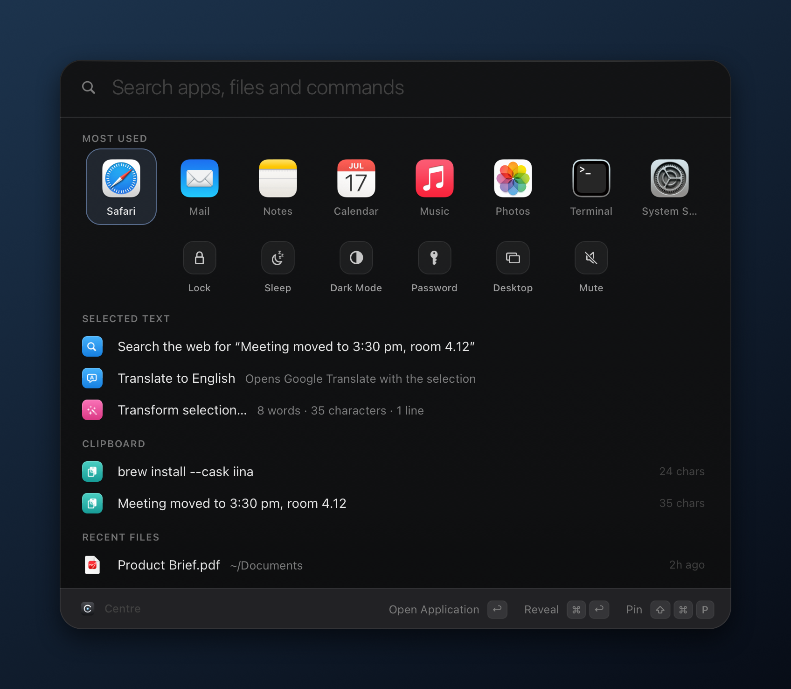
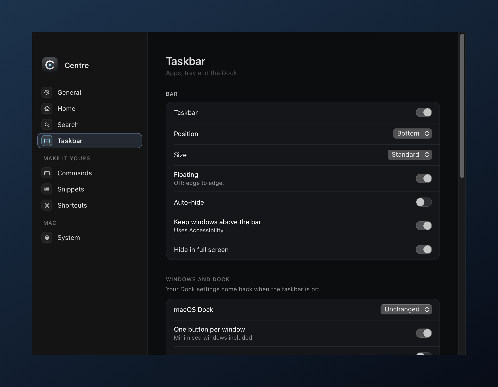

<p align="center">
  
</p>

<h1 align="center">Centre</h1>

<p align="center">
  A native macOS launcher and taskbar. One keystroke from anything.
</p>

<p align="center">
  <a href="https://github.com/Yyas99/Centre/releases/latest"></a>
  
  
  
</p>

<p align="center">
  
</p>

## What it does

- **Search** apps, settings, commands, files, open browser tabs and clipboard history, ranked by what you use at this hour.
- **Home** adapts to where you came from: a browser's other tabs, a terminal's last commands, actions for selected text.
- **Status line, notes and shelf:** time, next event and battery at a glance; `note …` keeps a line on Home; drop files onto the shelf.
- **Tools:** calculator, units, dictionary, timers, passwords, text transforms, time zones, emoji and window snapping.
- **Taskbar (optional):** one button per window, music controls, tray and clock, with windows kept clear of the bar.

<table>
  <tr>
    <td width="50%"></td>
    <td width="50%"></td>
  </tr>
  <tr>
    <td align="center"><sub>Opened from Safari: status line, a note, that window's tabs</sub></td>
    <td align="center"><sub><code>tab guide</code> jumps to any open tab</sub></td>
  </tr>
  <tr>
    <td width="50%"></td>
    <td width="50%"></td>
  </tr>
  <tr>
    <td align="center"><sub>Select text anywhere, then open Centre</sub></td>
    <td align="center"><sub>Eight pages of settings, no config files needed</sub></td>
  </tr>
</table>

<p align="center">
  
</p>

## Keys

| Input | Does |
| --- | --- |
| `⌘ Space` · hold it | Open Centre · quick glance |
| `⌘ ↩` · `⌘ 1–9` · `⇧ ⌘ P` | Alternate action · run by position · pin to Home |
| `note …` · `tab …` · `clip` · `f …` | Note · browser tab · clipboard · files |
| `> cmd` · `pw 24` · `5 km to mi` · `timer 10m` | Shell · password · units · timer |
| `save session Study` · `Study` | Save and restore window layouts |

## Install

1. Download **Centre-x.y.z.dmg** from [Releases](https://github.com/Yyas99/Centre/releases/latest), open it and drag Centre into Applications.
2. The first time, macOS says it can't check Centre for malware, because it isn't notarised by Apple. Open **System Settings › Privacy & Security** and click **Open Anyway**.
3. Turn off Spotlight's `⌘ Space` shortcut (System Settings › Keyboard › Keyboard Shortcuts › Spotlight), or choose another one in Centre.

**Updates** install themselves from **Settings › General › Updates**. A new version is only accepted if it's signed by the same certificate, so your permissions carry over. **Uninstall** from **Settings › System**. Your settings are kept in `~/Library/Application Support/Centre`.

**Privacy:** no accounts and no analytics. Centre only goes online to check GitHub for updates, fetch YouTube Music artwork, and look up your public IP when you run `info`. Clipboard history stays in memory.

## Build from source

You need macOS 13 or later and the Command Line Tools (`xcode-select --install`).

```sh
bash setup-signing.sh   # once: a private signing certificate, so rebuilds keep their permissions
./centre                # build, self-test (66 checks) and run
./centre release        # Centre-<VERSION>.dmg and the update .zip, in dist/
```

## Credits

Built by [Yyas99](https://github.com/Yyas99) with [Claude](https://claude.ai) (Anthropic). Screenshots are rendered by the app itself (`./centre shots`).
