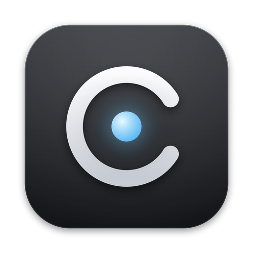
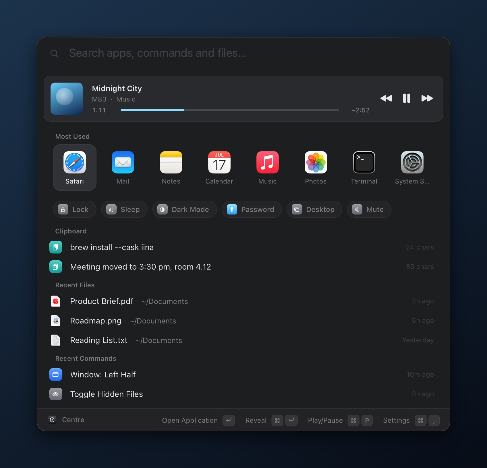
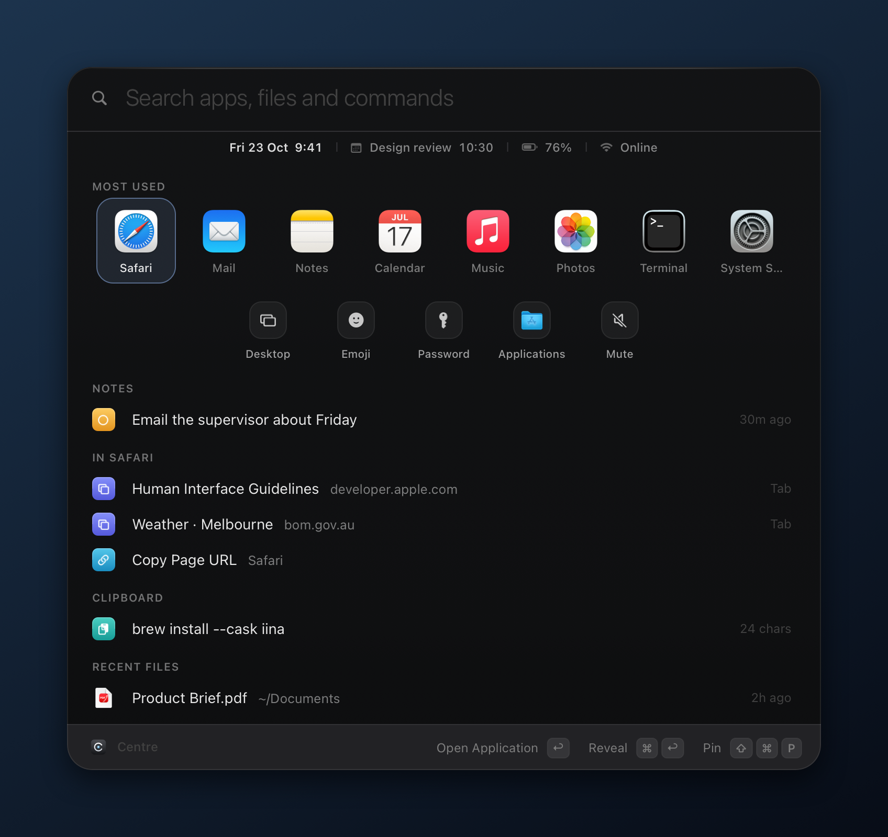
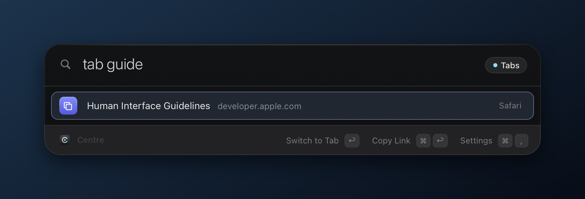
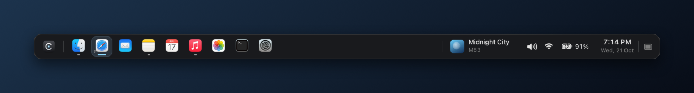

  

<h1 align="center">Centre</h1>

  A native macOS launcher and taskbar. One keystroke from anything. 
  Objective-C · AppKit · no Xcode · no dependencies · no telemetry

  

## What it does

- **Search** apps, settings, commands, files, open browser tabs and clipboard history, ranked by what you use at this hour.
- **Home** adapts to where you came from: a browser's other tabs, a terminal's last commands, actions for selected text.
- **Status line, notes and shelf:** time, next event, battery; `note …` keeps a line on Home; drop files onto the shelf.
- **Tools:** calculator, units, dictionary, timers, passwords, text transforms, time zones, emoji, window snapping.
- **Taskbar (optional):** one button per window, music controls, tray and clock; keeps windows clear of the bar.

<table>
  <tr>
    <td width="50%"></td>
    <td width="50%"></td>
  </tr>
  <tr>
    <td align="center">Opened from Safari: status line, a note, that window's tabs</td>
    <td align="center"><code>tab guide</code> jumps to any open tab</td>
  </tr>
</table>

  

## Keys and prefixes

| Input | Does |
| --- | --- |
| `⌘ Space` · hold it | Open Centre · quick glance |
| `⌘ ↩` · `⌘ 1–9` · `⇧ ⌘ P` | Alternate action · run by position · pin to Home |
| `note …` · `tab …` · `clip` · `f …` | Note · browser tab · clipboard · files |
| `> cmd` · `pw 24` · `5 km to mi` · `timer 10m` | Shell · password · units · timer |
| `save session Study` · `Study` | Save and restore window layouts |

## Install

Needs macOS 13 or later and the Command Line Tools (`xcode-select --install`).

1. Run `bash setup-signing.sh` once. It creates a private signing certificate so macOS keeps Centre's permissions across updates.
2. Run `./centre install`. It builds, self-tests (66 checks), signs and installs Centre in `/Applications`.
3. Turn off Spotlight's `⌘ Space` (System Settings › Keyboard › Keyboard Shortcuts › Spotlight), or pick another shortcut in Centre's settings.

Run `./centre install` again to update. To remove Centre, use **Settings › System › Uninstall**: it restores your Dock and removes the login item. Settings live in `~/Library/Application Support/Centre`.

No accounts or analytics. Centre only goes online to fetch YouTube Music artwork and, when you run `info`, your public IP. Clipboard history stays in memory.

## Credits

Built by [Yyas99](https://github.com/Yyas99) with [Claude](https://claude.ai) (Anthropic).
 Screenshots are rendered by the app: <code>./centre shots</code>
