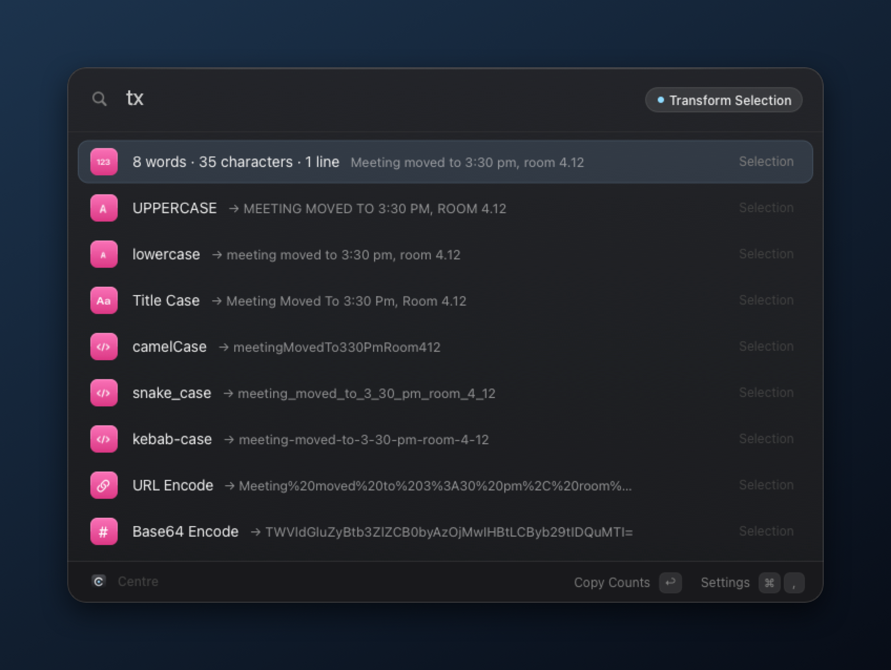
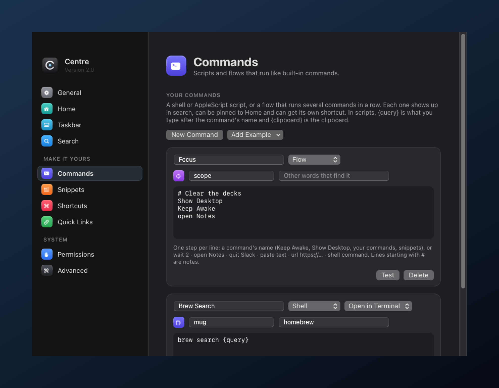

<p align="center">
  
</p>

<h1 align="center">Centre</h1>

<p align="center">
  A fast, native launcher for macOS. One keystroke from anything.<br>
  <sub>Plain Objective-C · no Xcode · no dependencies · no telemetry</sub>
</p>

<p align="center">
  
  
  
</p>

<p align="center">
  
</p>

## Highlights

- **One search for everything.** Apps, System Settings panes, commands, quick links and files (via Spotlight), ranked by how often you use them.
- **A home screen that knows what you were doing.** Select text anywhere and Home offers to search, define, translate or transform it. Open Centre from a browser and it lists that window's other tabs and can copy the page as a link, a Markdown link or a clean URL; from a terminal it offers your last commands; from Finder it opens Terminal there or copies paths. Below that: now playing, the apps you usually open at this hour, your pins, clipboard, recent files and commands.
- **A quiet status line.** Under the search field: the time, your next event, a running timer, battery and network.
- **Notes and tabs.** `note call the bank` keeps a line on Home until you tick it off. `tab` searches every open tab in Brave, Chrome, Arc, Edge, Vivaldi, Helium and Safari and jumps straight to it.
- **Glance, shelf and sessions.** Hold `⌘ Space` for a glance (time, next event, music, battery, last copy) that disappears when you let go. Drag anything onto the drop zone at the top of the screen and it waits on Home's shelf. `save session Study` remembers which apps are open and where; typing `Study` puts it all back. Rest on a file or clipboard entry to preview it beside the panel.
- **A taskbar, too.** An optional floating bar along the bottom: pinned and running apps with live indicators, window lists, now playing, volume, Wi-Fi, battery and a clock. It can hide the macOS Dock while it's on, and gives your Dock back exactly as it was.
- **Yours to shape.** Pin anything to Home with `⇧⌘P`. Write your own shell or AppleScript commands, chain commands into flows, save snippets, and give any of them a global shortcut.
- **Tools built in.** Calculator and unit conversions, offline dictionary, timers, volume, Keep Awake, password / passphrase / PIN generator, clipboard history, window snapping (halves, thirds, next display), quit and force-quit.
- **Keyboard first.** Arrow keys everywhere, `⌘1`–`⌘9` to jump, `⌘↩` for the alternate action, `Tab` to complete.
- **Native and light.** AppKit with an obsidian glass look: deep, matte and translucent, with one ice-blue focus ring so you always know what `↩` will do. The player takes its accent from the album art, and its × hides it until the next song plays. Every build checks itself before it replaces the running app.

<table>
  <tr>
    <td width="50%"></td>
    <td width="50%"></td>
  </tr>
  <tr>
    <td align="center"><sub>Opened from Safari: the status line, a note and that window's other tabs</sub></td>
    <td align="center"><sub><code>tab guide</code> finds any open tab and jumps to it</sub></td>
  </tr>
  <tr>
    <td width="50%"></td>
    <td width="50%"></td>
  </tr>
  <tr>
    <td align="center"><sub>Commands get System Settings–style tiles</sub></td>
    <td align="center"><sub><code>pw 24</code> gives strong, symbol-free, passphrase and PIN options</sub></td>
  </tr>
  <tr>
    <td width="50%"></td>
    <td width="50%"></td>
  </tr>
  <tr>
    <td align="center"><sub>Select text anywhere, open Centre: search, translate or transform it</sub></td>
    <td align="center"><sub><code>tx</code> previews every transform before it replaces the selection</sub></td>
  </tr>
</table>

## Taskbar

<p align="center">
  
</p>

A floating bar in the spirit of KDE Plasma's panel, on every Space, hidden while anything is full screen.

- **Apps:** pinned apps, then anything else running, with one button per window if you like (minimised and private windows included). A short line marks a running app; the one in front is lit. Click to bring an app or window forward, again to hide it; an app with no windows opens a new one. Drag pinned apps to reorder; right-click for its windows, Hide, Pin, Quit and Force Quit (Finder offers Relaunch instead).
- **Windows:** windows are kept just above the bar instead of sliding under it, even after zooming. Optional quick minimise makes windows vanish instantly instead of animating into the Dock.
- **Tray:** now playing with previous, play and next, a scrolling title and a player popover (any app macOS reports as playing, plus YouTube Music); a mirror of your menu bar icons (off by default); volume (scroll to change, click to mute), Wi-Fi, battery, and a clock that opens a calendar. Right-click any of them for its System Settings page.
- **Show desktop:** hides every app; click again to bring back exactly those windows.
- **Settings › Taskbar:** bottom or top, three sizes, floating or edge to edge, auto-hide, app names, 24-hour time, each tray item, and what the Dock does while the bar is on (stays, auto-hides, or is turned off; your own Dock settings come back when the bar is off or Centre quits). Window snapping leaves the bar uncovered.

## Keys

| Key | Action |
| --- | --- |
| `⌘ Space` | Open or close Centre |
| `↩` | Run the selected item |
| `Esc` | Clear the search, then close |
| `⌘ ↩` | Alternate action: reveal in Finder, copy only, force quit |
| `⌘ 1` … `⌘ 9` | Run an item by position (hold `⌘` to see the numbers) |
| `⌘ P` · `⌘ [` · `⌘ ]` | Play / pause · previous · next |
| `⇧ ⌘ P` | Pin or unpin the selection on Home |
| `⌘ ,` | Settings |
| `Tab` | Complete an app name or a path |

## Prefixes

| Type | What it does |
| --- | --- |
| `clip` · `v ` | Search clipboard history |
| `f report` · `find report` | Search files |
| `note call the bank` · `notes` | Keep a line on Home, or see them all |
| `tab guide` · `tabs` | Search open browser tabs and jump to one |
| `save session Study` · `Study` | Save the open apps and window positions; type the name to restore |
| `/documents` · `~/doc/rep` | Open folders and files by path, any case; `Tab` completes like a shell |
| `pw 32` | Generate passwords of a given length |
| `quit` · `kill` | Quit or force-quit running apps |
| `> command` | Run in Terminal (`⌘↩` runs silently and copies the output) |
| `yt lofi` | Keyword web search: `g`, `yt`, `gh`, `wiki`, `x`, `amz`, or your own |
| `128*0.15+12` | Calculate and copy the answer |
| `5 km to mi` · `100 f to c` | Convert length, mass, volume, time, data, speed and temperature |
| `define serendipity` | Look a word up in the macOS dictionary (works offline) |
| `timer 10m tea` · `timers` | Start a timer (`90s`, `1h30m`, `25`) or see and cancel running ones |
| `vol 40` | Set the output volume |
| `w safari` | Switch to any open window by its title |
| `tx` · `upper` | Transform the selection or clipboard: case, JSON, Base64, URL encoding, clean URLs, line tools |
| `snip` · your keyword | Paste a snippet; `{date}`, `{time}`, `{clipboard}` and more are filled in |
| `time in tokyo` · `3pm melbourne in london` | Time zones, offline |
| `:heart` | Paste any emoji by name |
| `port 3000` | See what's listening and stop it |
| `info` | Battery, IP addresses, disk, memory, uptime |

## Build and run

Needs only the Xcode Command Line Tools (`xcode-select --install`).

```sh
./centre          # build if Sources/ changed, then launch
./centre build    # force a rebuild
./centre stop     # quit
```

Or double-click **Rebuild Centre.command**. While Centre is running, saving any file in `Sources/` rebuilds and relaunches it automatically.

Each new build runs `Centre --selftest` (66 checks: calculator, units, durations, paths, transforms, time zones, snippets, hotkeys, emoji) and only replaces the app if every check passes; otherwise the working version stays and the reason is in `build.log`.

| File | Contains |
| --- | --- |
| `Centre.h` · `Util.m` · `Theme.m` | Model, shared helpers, design tokens and the HUD |
| `Views.h` · `Views.m` | Panel, rows, grid, home lists and the media player |
| `App.m` · `App+*.m` | The app: Search, Home, UI, Media, Tools, Library (pins, your commands, flows, snippets, shortcuts), Context (selection, app actions, windows), Deck (tabs, notes, status line), Glance (peek, shelf, sessions, preview) and Snapshots |
| `Logic.m` | Pure logic for transforms, time zones, snippets, hotkeys and emoji — covered by the self-test |
| `Taskbar.m` | The taskbar: layout, drawing, tray, Dock handling and auto-hide |
| `Settings.m` | The settings window |
| `SelfTest.m` · `main.m` | Build checks and the entry point |

> [!NOTE]
> Centre uses `⌘ Space` by default. Turn off Spotlight's shortcut first (System Settings › Keyboard › Keyboard Shortcuts › Spotlight), or choose another hotkey in Centre's settings.

## Settings and permissions

Everything is set in a native settings window (`⌘ ,`) and stored in `~/Library/Application Support/Centre/config.json`. Home, Taskbar, Commands, Snippets and Shortcuts each have their own page: reorder pins, set up the taskbar, write and test commands, edit snippets and record shortcuts there. If `config.json` ever has a typo, Centre keeps your last good settings and saves a copy as `config.json.broken`.

<table>
  <tr>
    <td width="50%"></td>
    <td width="50%"></td>
  </tr>
  <tr>
    <td align="center"><sub>Your commands: shell, AppleScript or a flow of steps</sub></td>
    <td align="center"><sub>Taskbar options, including what the Dock does</sub></td>
  </tr>
</table>

**Settings › Permissions** shows what Centre can access and fixes what's missing. Its *Stable signature* step (`setup-signing.sh`) creates a private code-signing certificate on your Mac, so rebuilds keep their permissions instead of macOS asking again after every build.

| Permission | Used for |
| --- | --- |
| Accessibility | Window snapping, the window switcher, pasting snippets and clipboard items, reading selected text, taskbar window lists |
| Automation | System commands (sleep, dark mode, empty trash), reading and switching browser tabs, and YouTube Music control |
| Calendar | Your next event in the status line and the glance (optional) |
| Documents | Recent files on the home screen |

## Privacy

No accounts and no analytics. Clipboard history lives in memory only (when Centre rebuilds itself it's handed to the new process through a private file that is deleted straight away) and skips items that password managers mark as concealed. Generated passwords are marked concealed too, and are cleared from the clipboard after 90 seconds. Notes, the shelf and window sessions stay on your Mac in Centre's own folder.

<br>


<p align="center"><sub>Screenshots are rendered by the app itself: <code>Centre.app/Contents/MacOS/Centre --readme docs</code></sub></p>
