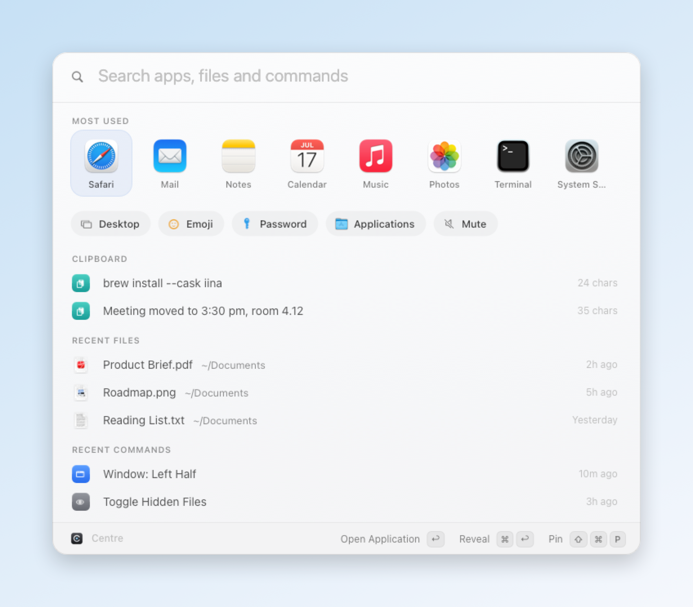
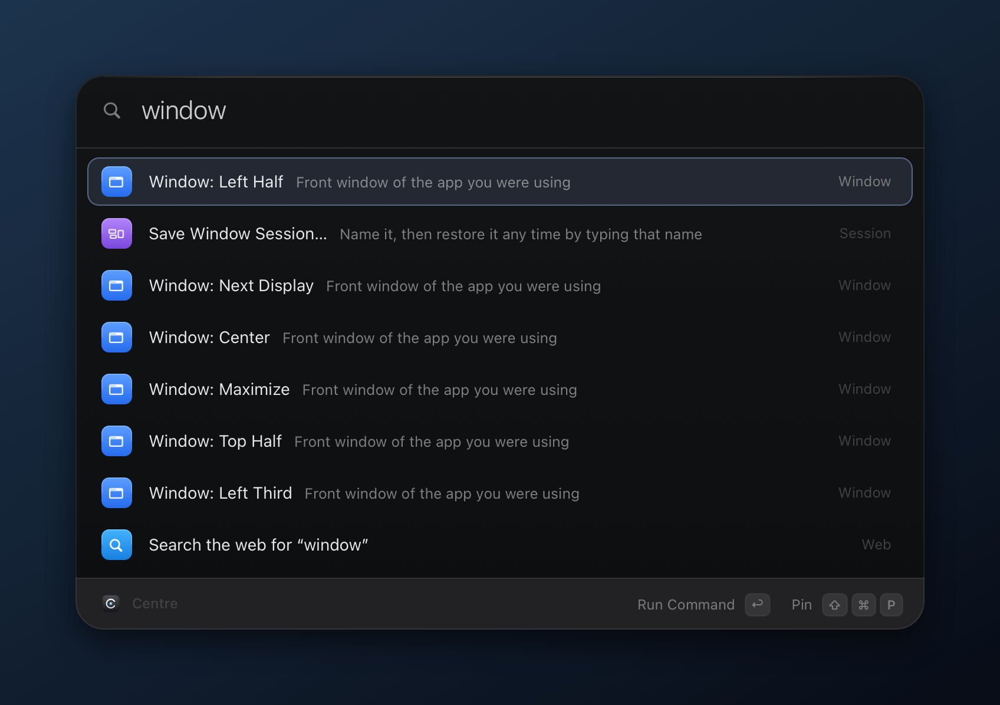
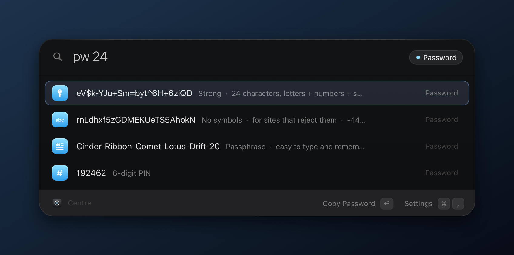

<p align="center">
  
</p>

<h1 align="center">Centre</h1>

<p align="center">
  A fast, native launcher for macOS. One keystroke from anything.<br>
  <sub>Plain Objective-C · no Xcode · no dependencies · no telemetry</sub>
</p>

<p align="center">
  
  
  
</p>

<p align="center">
  <picture>
    <source media="(prefers-color-scheme: dark)" srcset="docs/home-dark.png">
    
  </picture>
</p>

## Highlights

- **One search for everything.** Apps, System Settings panes, commands, quick links and files (via Spotlight), ranked by how often you use them.
- **A home screen worth opening.** Now playing with a scrub bar, most-used apps, one-click actions, your latest clipboard, recent files and recent commands.
- **Tools built in.** Calculator and unit conversions, offline dictionary, timers, volume, Keep Awake, password / passphrase / PIN generator, clipboard history, window snapping (halves, thirds, next display), quit and force-quit.
- **Keyboard first.** Arrow keys everywhere, `⌘1`–`⌘9` to jump, `⌘↩` for the alternate action, `Tab` to complete.
- **Native and light.** AppKit, vibrancy, light and dark mode. Every build checks itself before it replaces the running app.

<table>
  <tr>
    <td width="50%"></td>
    <td width="50%"></td>
  </tr>
  <tr>
    <td align="center"><sub>Commands get System Settings–style tiles</sub></td>
    <td align="center"><sub><code>pw 24</code> gives strong, symbol-free, passphrase and PIN options</sub></td>
  </tr>
</table>

## Keys

| Key | Action |
| --- | --- |
| `⌘ Space` | Open or close Centre |
| `↩` | Run the selected item |
| `Esc` | Clear the search, then close |
| `⌘ ↩` | Alternate action: reveal in Finder, copy only, force quit |
| `⌘ 1` … `⌘ 9` | Run an item by position (hold `⌘` to see the numbers) |
| `⌘ P` · `⌘ [` · `⌘ ]` | Play / pause · previous · next |
| `⌘ ,` | Settings |
| `Tab` | Complete an app name or a path |

## Prefixes

| Type | What it does |
| --- | --- |
| `clip` | Search clipboard history |
| `f report` | Search files |
| `/documents` · `~/doc/rep` | Open folders and files by path, any case; `Tab` completes like a shell |
| `pw 32` | Generate passwords of a given length |
| `quit` · `kill` | Quit or force-quit running apps |
| `> command` | Run in Terminal (`⌘↩` runs silently and copies the output) |
| `yt lofi` | Keyword web search: `g`, `yt`, `gh`, `wiki`, `x`, `amz`, or your own |
| `128*0.15+12` | Calculate and copy the answer |
| `5 km to mi` · `100 f to c` | Convert length, mass, volume, time, data, speed and temperature |
| `define serendipity` | Look a word up in the macOS dictionary (works offline) |
| `timer 10m tea` · `timers` | Start a timer (`90s`, `1h30m`, `25`) or see and cancel running ones |
| `vol 40` | Set the output volume |

## Build and run

Needs only the Xcode Command Line Tools (`xcode-select --install`).

```sh
./centre          # build if Sources/ changed, then launch
./centre build    # force a rebuild
./centre stop     # quit
```

Or double-click **Rebuild Centre.command**. While Centre is running, saving any file in `Sources/` rebuilds and relaunches it automatically.

Each new build runs `Centre --selftest` (calculator, units, durations, passwords, fuzzy matching) and only replaces the app if every check passes; otherwise the working version stays and the reason is in `build.log`.

| File | Contains |
| --- | --- |
| `Centre.h` · `Util.m` · `Theme.m` | Model, shared helpers, design tokens and the HUD |
| `Views.h` · `Views.m` | Panel, rows, grid, home lists and the media player |
| `App.m` · `App+*.m` | The app, split into Search, Home, UI, Media, Tools and Snapshots |
| `Settings.m` | The settings window |
| `SelfTest.m` · `main.m` | Build checks and the entry point |

> [!NOTE]
> Centre uses `⌘ Space` by default. Turn off Spotlight's shortcut first (System Settings › Keyboard › Keyboard Shortcuts › Spotlight), or choose another hotkey in Centre's settings.

## Settings and permissions

Everything is set in a native settings window (`⌘ ,`) and stored in `~/Library/Application Support/Centre/config.json`.

**Settings › Permissions** shows what Centre can access and fixes what's missing. Its *Stable signature* step (`setup-signing.sh`) creates a private code-signing certificate on your Mac, so rebuilds keep their permissions instead of macOS asking again after every build.

| Permission | Used for |
| --- | --- |
| Accessibility | Window snapping and pasting from clipboard history |
| Automation | System commands (sleep, dark mode, empty trash) and YouTube Music control |
| Documents | Recent files on the home screen |

## Privacy

No accounts and no analytics. Clipboard history lives in memory only (when Centre rebuilds itself it's handed to the new process through a private file that is deleted straight away) and skips items that password managers mark as concealed. Generated passwords are marked concealed too, and are cleared from the clipboard after 90 seconds.

<br>

<p align="center"><sub>Screenshots are rendered by the app itself: <code>Centre.app/Contents/MacOS/Centre --readme docs</code></sub></p>
